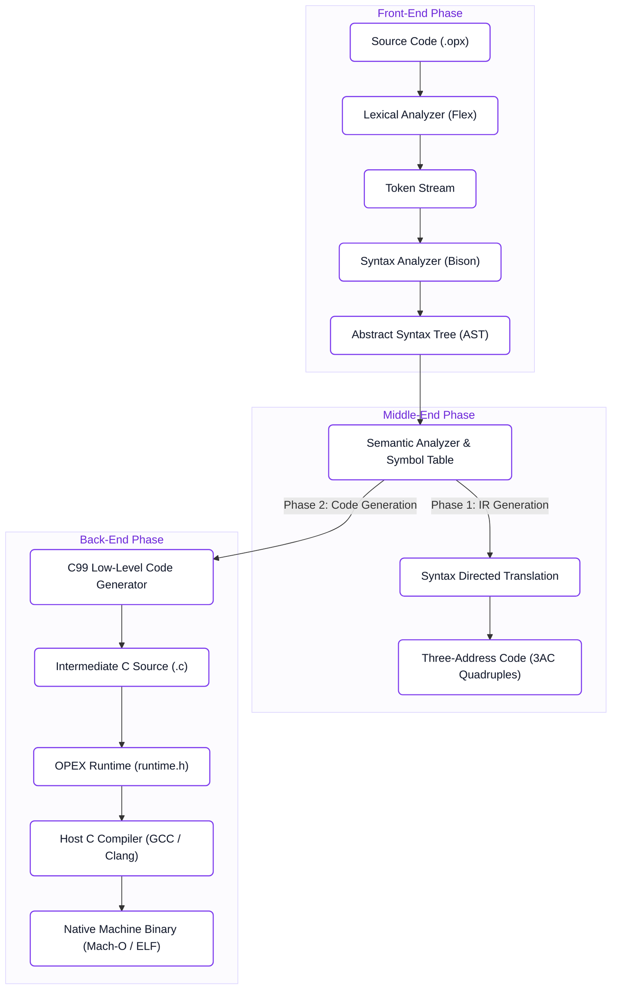

# Compiler Architecture & Pipeline

The OPEX compiler is built using a classical multi-pass architecture, engineered for correctness, clean abstractions, and native machine execution.

---

## High-Level Compilation Flow

---

## Architectural Stages

### 1. Front-End: Lexing & Parsing
- **Scanner**: Implemented in Flex ([`src/lexer.l`](https://github.com/gaurav-budhwani/OPEX/blob/main/src/lexer.l)). Recognizes keywords, literals, range operators, and comments. Automatically tracks column and line coordinates via `YY_USER_ACTION`.
- **Parser**: Implemented in Bison ([`src/parser.y`](https://github.com/gaurav-budhwani/OPEX/blob/main/src/parser.y)). Validates syntax against an LALR(1) Context-Free Grammar.
- **AST Construction**: Semantic actions dynamically allocate memory for an N-ary Abstract Syntax Tree ([`src/ast.c`](https://github.com/gaurav-budhwani/OPEX/blob/main/src/ast.c)).

### 2. Middle-End: Semantic Validation & 3AC
- **Semantic Analyzer**: Traverses the AST with a scoped symbol table to catch undeclared variables and duplicate declarations ([`src/semantic.c`](https://github.com/gaurav-budhwani/OPEX/blob/main/src/semantic.c)).
- **Intermediate Representation**: Post-order AST traversal emits Three-Address Code (3AC) Quadruples (`op, arg1, arg2, result`) managing temporary registers and jump labels ([`src/ir.c`](https://github.com/gaurav-budhwani/OPEX/blob/main/src/ir.c)).

### 3. Back-End: Native Code Generation
- **Target Lowering**: Lowers the verified AST into clean, structured C99 ([`src/codegen.c`](https://github.com/gaurav-budhwani/OPEX/blob/main/src/codegen.c)).
- **Runtime Library**: Links against a self-contained header ([`src/runtime.h`](https://github.com/gaurav-budhwani/OPEX/blob/main/src/runtime.h)) implementing memory buffers, convolution, and image filtering.
- **Native Execution**: Invokes `gcc`/`clang` to generate bare-metal executables.

