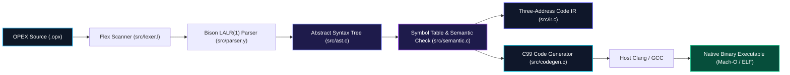

---
hide:
  - feedback
---

<div class="hero-wrapper">
  <div class="hero-badge">
    <span class="pulse-dot"></span> OPEX v1.0 • CS327 Compilers Engineering
  </div>
  <h1 class="hero-title">The OPEX Programming Language</h1>
  <p class="hero-subtitle">
    A high-performance domain-specific compiled language uniting algorithmic computing, first-class computer vision tensors, 2D convolution, and native bare-metal execution.
  </p>
  <div class="hero-actions">
    <a href="getting-started/installation/" class="btn-primary">
      <span>Get Started</span>
      <svg xmlns="http://www.w3.org/2000/svg" width="16" height="16" viewBox="0 0 24 24" fill="none" stroke="currentColor" stroke-width="2.5" stroke-linecap="round" stroke-linejoin="round"><line x1="5" y1="12" x2="19" y2="12"></line><polyline points="12 5 19 12 12 19"></polyline></svg>
    </a>
    <a href="compiler-internals/pipeline/" class="btn-secondary">
      <span>Compiler Architecture</span>
    </a>
    <a href="https://github.com/gaurav-budhwani/OPEX" target="_blank" class="btn-secondary">
      <span>GitHub Repository ↗</span>
    </a>
  </div>
</div>

<div class="feature-grid">
  <div class="feature-card">
    <div class="card-icon">⚡</div>
    <h3>Computer Vision Primitives</h3>
    <p>First-class language types for <code>IMAGE</code>, <code>MATRIX</code>, <code>KERNEL</code>, and <code>PIXEL</code>. Process multi-channel tensors directly with clean syntax instead of boilerplate C pointer APIs.</p>
    <span class="card-tag">IMAGE / MATRIX / KERNEL</span>
  </div>

  <div class="feature-card">
    <div class="card-icon">⚙️</div>
    <h3>Convolution & Pipeline Operators</h3>
    <p>Native 2D spatial convolution via infix <code>**</code> and Unix-style stream processing via <code>|></code>. Chain operations like <code>img |> GRAYSCALE |> THRESHOLD(50)</code> seamlessly.</p>
    <span class="card-tag">** and |&gt; Operators</span>
  </div>

  <div class="feature-card">
    <div class="card-icon">🛡️</div>
    <h3>Scoped Semantic Type Checker</h3>
    <p>Hierarchical symbol table with lexical scoping, variable shadowing protection, undeclared identifier catching, and strict parameter type validation before code generation.</p>
    <span class="card-tag">src/semantic.c</span>
  </div>

  <div class="feature-card">
    <div class="card-icon">📐</div>
    <h3>Three-Address Code (3AC)</h3>
    <p>Deterministic quadruple intermediate representation (<code>[OP, ARG1, ARG2, RES]</code>) with temporary register allocation and structured control flow labeling.</p>
    <span class="card-tag">src/ir.c (Quadruples)</span>
  </div>

  <div class="feature-card">
    <div class="card-icon">🚀</div>
    <h3>Native C99 Code Generator</h3>
    <p>Lowers high-level AST and vision operations into standalone, zero-dependency C99 code, compiling down to optimized <strong>Mach-O / ELF</strong> native binaries.</p>
    <span class="card-tag">Clang / GCC Backend</span>
  </div>

  <div class="feature-card">
    <div class="card-icon">💻</div>
    <h3>Unified Multi-Mode CLI</h3>
    <p>Single compiler binary supporting live on-the-fly execution (<code>--run</code>), binary compilation (<code>-o &lt;bin&gt;</code>), semantic verification (<code>--check</code>), and grammar derivation dumps.</p>
    <span class="card-tag">./opex CLI</span>
  </div>
</div>

---

## 🔍 Language Showcase

See how OPEX expressively handles complex computer vision pipelines in just a few lines of code:

<div class="terminal-frame" markdown="1">
<div class="terminal-header">
  <span class="terminal-dot dot-red"></span>
  <span class="terminal-dot dot-yellow"></span>
  <span class="terminal-dot dot-green"></span>
  <span class="terminal-title">edge_detection.opx — Multi-Stage Compilation Pipeline</span>
</div>

=== "Pure OPEX Source"
    ```opex
    PROGRAM EdgeDetectionPipeline
    BEGIN
        // 1. Declare 3x3 Sobel spatial kernels
        KERNEL sobelX := [[-1, 0, 1], [-2, 0, 2], [-1, 0, 1]]
        KERNEL sobelY := [[-1, -2, -1], [ 0,  0,  0], [ 1,  2,  1]]

        // 2. Load test image & convert to grayscale
        AUTO img   := LOAD("input.jpg")
        AUTO gray  := GRAYSCALE(img)

        // 3. Convolve with Sobel filters and chain through thresholding
        AUTO edges := ((gray ** sobelX) + (gray ** sobelY)) |> THRESHOLD(50)

        // 4. Export result
        SAVE(edges, "edges.ppm")
        PRINT "Processed {img.width}x{img.height} image successfully."
    END
    ```

=== "Three-Address Intermediate Code (3AC)"
    ```text
    === THREE-ADDRESS CODE QUADRUPLES ===
    [0001] PARAM       "input.jpg"             -                  -
    [0002] CALL        LOAD                    1                  t1
    [0003] ASSIGN      t1                      -                  img
    [0004] PARAM       img                     -                  -
    [0005] CALL        GRAYSCALE               1                  t2
    [0006] ASSIGN      t2                      -                  gray
    [0007] CONV2D      gray                    sobelX             t3
    [0008] CONV2D      gray                    sobelY             t4
    [0009] ADD         t3                      t4                 t5
    [0010] PARAM       50                      -                  -
    [0011] PIPE        t5                      THRESHOLD          t6
    [0012] ASSIGN      t6                      -                  edges
    ```

=== "Compiled Native Execution"
    ```bash
    $ ./opex --run tests/edge_detection.opx
    Generating synthetic 64x64 sample image...
    Image generated: 64x64 pixels.
    Converting to grayscale...
    Applying Sobel-X and Sobel-Y convolution...
    Applying binary threshold filter (threshold = 60)...
    Saving edge map to 'edges.ppm'...
    Saved 'edges.ppm' successfully!
    Generated image viewer script: view_edges.py
    Run: python3 view_edges.py to inspect the output.
    ```
</div>

---

## 🏗️ Compiler Architecture Pipeline

OPEX is engineered with a modular multi-stage compilation pipeline:



---

## 🚀 Quick Start in 60 Seconds

Clone and compile the entire compiler engine with zero external dependencies:

=== "macOS & Linux"
    ```bash
    # 1. Clone repository
    git clone https://github.com/gaurav-budhwani/OPEX.git
    cd OPEX

    # 2. Build the compiler binary
    make

    # 3. Execute any OPEX program instantly
    ./opex --run tests/bubble_sort.opx

    # 4. Or compile directly to a standalone native binary
    ./opex -o bubble_sort tests/bubble_sort.opx
    ./bubble_sort
    ```

=== "Run Full Test Suite"
    ```bash
    # Test all 16 grammar and language test files
    make test_all

    # Run scoped semantic type-checker on all suites
    make test_semantic

    # Execute interactive programs (sorting, matrix mult, queues, stacks, CV)
    make test_run
    ```

---

## 👥 Course & Contributors

This compiler was developed for **CS327: Compilers** at the **Indian Institute of Technology Gandhinagar (IITGN)** under the guidance of **Prof. Shouvick Mondal**.

| Contributor | Roll Number | Focus Area |
| :--- | :--- | :--- |
| **Gaurav Budhwani** | `22110085` | Compiler Architecture, LALR(1) Grammar, Semantic Analysis, C99 Codegen, Documentation |
| **John Twipraham Debbarma** | `22110108` | Lexical Analysis (Flex), Intermediate Code Generation (3AC), Test Suite Curation |
| **Harshit** | `22110095` | Computer Vision Built-ins, Matrix Arithmetic & Convolution Kernels |
