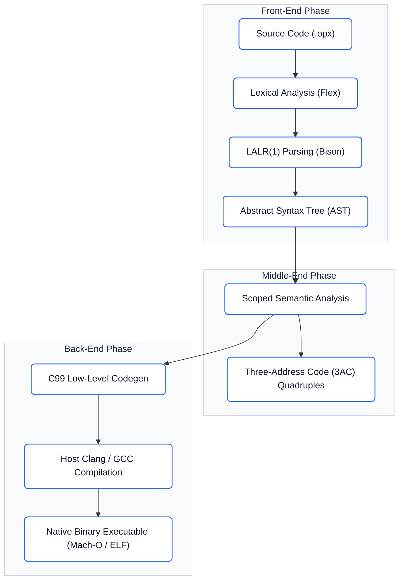

<div class="hero-box">
  <div class="hero-inner">
    <div class="hero-content">
      <div class="hero-tags">
        <span class="pill-cobalt">Optimizing Compiler</span>
        <span class="pill-subtle">C99 Backend</span>
        <span class="pill-subtle">Flex & Bison</span>
        <span class="pill-subtle">3AC Quadruples</span>
        <span class="pill-subtle">Computer Vision</span>
      </div>
      <h1 class="hero-headline">OPEX</h1>
      <p class="hero-desc">
        Optimized Processing Engine for eXecution. A statically-typed domain-specific compiled language bridging algorithmic computing with first-class computer vision tensors, spatial convolution, and bare-metal native execution.
      </p>
      <div class="hero-buttons">
        <a href="getting-started/installation/" class="btn-cobalt">
          Documentation <span>&rarr;</span>
        </a>
        <a href="compiler-internals/pipeline/" class="btn-outline">
          Compiler Architecture
        </a>
        <a href="https://github.com/gaurav-budhwani/OPEX" target="_blank" class="btn-outline">
          GitHub Repository <span>&rarr;</span>
        </a>
      </div>
    </div>
    <div class="hero-mascot">
      
    </div>
  </div>
</div>

## Architecture

<div class="minimal-grid">
  <div class="minimal-card">
    <h3>Computer Vision Primitives</h3>
    <p>First-class language types for <code>IMAGE</code>, <code>MATRIX</code>, <code>KERNEL</code>, and <code>PIXEL</code>. Direct memory layout and pixel channel manipulation without external library wrappers.</p>
    <span class="card-mono">IMAGE / MATRIX / KERNEL</span>
  </div>

  <div class="minimal-card">
    <h3>Convolution and Pipeline Operators</h3>
    <p>2D spatial convolution via infix <code>**</code> and functional stream processing via <code>|&gt;</code>. Enables concise chaining such as <code>img |&gt; GRAYSCALE |&gt; THRESHOLD(50)</code>.</p>
    <span class="card-mono">** and |&gt; Operators</span>
  </div>

  <div class="minimal-card">
    <h3>Scoped Semantic Type Checker</h3>
    <p>Hierarchical symbol table with lexical scoping, variable shadowing rules, undeclared identifier validation, and strict parameter type checking before lowering.</p>
    <span class="card-mono">src/semantic.c</span>
  </div>

  <div class="minimal-card">
    <h3>Three-Address Code Intermediate Representation</h3>
    <p>Deterministic intermediate code represented as quadruples (<code>[OP, ARG1, ARG2, RES]</code>) with temporary register allocation and structured control flow labeling.</p>
    <span class="card-mono">src/ir.c (Quadruples)</span>
  </div>

  <div class="minimal-card">
    <h3>Native C99 Code Generator</h3>
    <p>Lowers the abstract syntax tree into clean, self-contained C99 code, compiling directly to standalone Mach-O and ELF native executable binaries.</p>
    <span class="card-mono">Clang / GCC Backend</span>
  </div>

  <div class="minimal-card">
    <h3>Unified Command-Line Driver</h3>
    <p>Single binary supporting immediate on-the-fly execution (<code>--run</code>), binary compilation (<code>-o &lt;bin&gt;</code>), semantic verification (<code>--check</code>), and grammar derivation dumps.</p>
    <span class="card-mono">./opex CLI</span>
  </div>
</div>

---

## Language Specification

The following example demonstrates an end-to-end edge detection pipeline written in OPEX:

=== "OPEX Source"
    ```opex
    PROGRAM EdgeDetectionPipeline
    BEGIN
        // 1. Declare 3x3 Sobel spatial kernels
        KERNEL sobelX := [[-1, 0, 1], [-2, 0, 2], [-1, 0, 1]]
        KERNEL sobelY := [[-1, -2, -1], [ 0,  0,  0], [ 1,  2,  1]]

        // 2. Load test image & convert to grayscale
        AUTO img   := LOAD("input.jpg")
        AUTO gray  := GRAYSCALE(img)

        // 3. Convolve with Sobel filters and chain through thresholding
        AUTO edges := ((gray ** sobelX) + (gray ** sobelY)) |> THRESHOLD(50)

        // 4. Export result
        SAVE(edges, "edges.ppm")
        PRINT "Processed {img.width}x{img.height} image successfully."
    END
    ```

=== "Three-Address Intermediate Code"
    ```text
    === THREE-ADDRESS CODE QUADRUPLES ===
    [0001] PARAM       "input.jpg"             -                  -
    [0002] CALL        LOAD                    1                  t1
    [0003] ASSIGN      t1                      -                  img
    [0004] PARAM       img                     -                  -
    [0005] CALL        GRAYSCALE               1                  t2
    [0006] ASSIGN      t2                      -                  gray
    [0007] CONV2D      gray                    sobelX             t3
    [0008] CONV2D      gray                    sobelY             t4
    [0009] ADD         t3                      t4                 t5
    [0010] PARAM       50                      -                  -
    [0011] PIPE        t5                      THRESHOLD          t6
    [0012] ASSIGN      t6                      -                  edges
    ```

=== "Native Execution"
    ```bash
    $ ./opex --run tests/edge_detection.opx
    Generating synthetic 64x64 sample image...
    Image generated: 64x64 pixels.
    Converting to grayscale...
    Applying Sobel-X and Sobel-Y convolution...
    Applying binary threshold filter (threshold = 60)...
    Saving edge map to 'edges.ppm'...
    Saved 'edges.ppm' successfully!
    Generated image viewer script: view_edges.py
    Run: python3 view_edges.py to inspect the output.
    ```

---

## Compiler Pipeline



---

## Quick Start

=== "Build from Source"
    ```bash
    # Clone repository
    git clone https://github.com/gaurav-budhwani/OPEX.git
    cd OPEX

    # Build compiler binary
    make

    # Run any OPEX program directly
    ./opex --run tests/bubble_sort.opx

    # Compile to a native binary
    ./opex -o bubble_sort tests/bubble_sort.opx
    ./bubble_sort
    ```

=== "Run Test Suites"
    ```bash
    # Validate all 16 language grammar test cases
    make test_all

    # Run scoped semantic type analysis
    make test_semantic

    # Execute interactive benchmark programs
    make test_run
    ```
